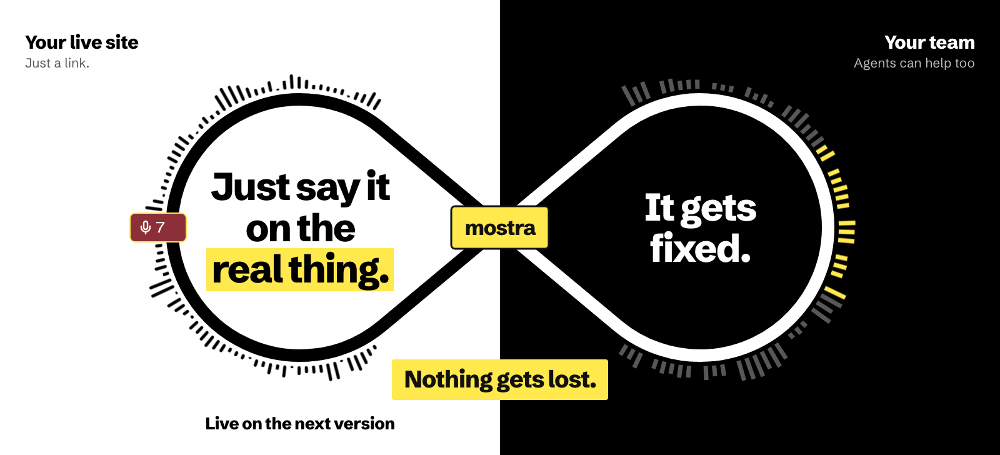

<picture>
  <source media="(prefers-color-scheme: dark)" srcset="docs/images/header-dark.svg">
  
</picture>

Get feedback on your real running site, not on a Figma prototype or a Loom recording. Send anyone a link. They click around and talk, and each point lands as a comment on the exact element. They need no account and install nothing. Your team picks the comments up, and a coding agent can help if you connect one.

This repository is the part of [mostra](https://mostra.design) that runs on your site: the script you add, and everything an invited reviewer sees on it. The comments live in your project on mostra.design.

<!-- The promo video: a github.com/user-attachments URL on its own line plays here. -->

## How it works

Someone comments on your live site. Your team gets the comment, fixes it or answers, and they see the result on the next version.

<picture>
  <source media="(prefers-color-scheme: dark)" srcset="docs/images/how-it-works-dark.gif">
  
</picture>

## Get started

Create a project at [mostra.design](https://mostra.design). Its Setup page has the tag below with your key filled in.

**1. Paste one tag.** Put it first in your page's head, so it clears an invite token from the address before other scripts can read it.

```html
<script
  src="https://mostra.design/mostra.js"
  data-project="pk_..."
  data-version="a1c94e2"
  defer></script>
```

Set `data-version` to your commit, and every deploy counts as its own version.

**2. Send a link.** Copy one from Invites in your dashboard. Whoever opens your site through it sees mostra. Everyone else sees nothing.

```
https://your-site.com/pricing?mostra=<token>
```

**3. Add your agent** (optional). In Claude Code, one command connects it over MCP, with a key from your Setup page.

```sh
claude mcp add --transport http mostra https://mostra.design/mcp \
  --header "Authorization: Bearer mostra_sk_..."
```

### With a bundler

Install the package instead of pasting the tag.

```sh
npm install @mostra-design/overlay
```

```ts
import { init } from '@mostra-design/overlay'

init({
  project: 'pk_...',
  version: import.meta.env.VITE_GIT_SHA, // your commit
})
```

## Off until someone is invited

Every visitor downloads a script of about 1 KB compressed. Without an invite it makes no requests, sets no cookies and changes nothing on your page. With one, the overlay loads in a shadow root, apart from your page's styles. What people type into forms is never captured.

## Check what you load

Every visitor runs this script, so you don't have to take our word for what's in it. The same commit builds the same bytes on any machine, and a workflow here compares the live script with a fresh build every hour. To compare it yourself:

```sh
curl https://mostra.design/release.json     # the commit the site serves
git checkout <commit>
pnpm install --frozen-lockfile && pnpm build
node scripts/check-script.js https://mostra.design/
```

What mostra.design serves is also signed. To check a file:

```sh
curl -O https://mostra.design/mostra.js
gh attestation verify mostra.js --repo mostra-design/overlay \
  --cert-identity https://github.com/mostra-design/overlay/.github/workflows/sign.yml@refs/heads/main \
  --source-digest <commit>
```

For a guarantee rather than a check, your project's Setup page has a tag pinned to one exact build.

## Security

To report a security problem in the script or on mostra.design, email security@mostra.design. Include steps to reproduce if you can. Please don't open a public issue or pull request.

## License

MIT
